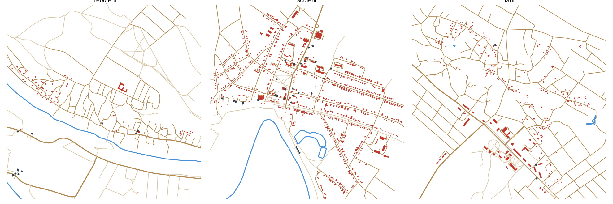
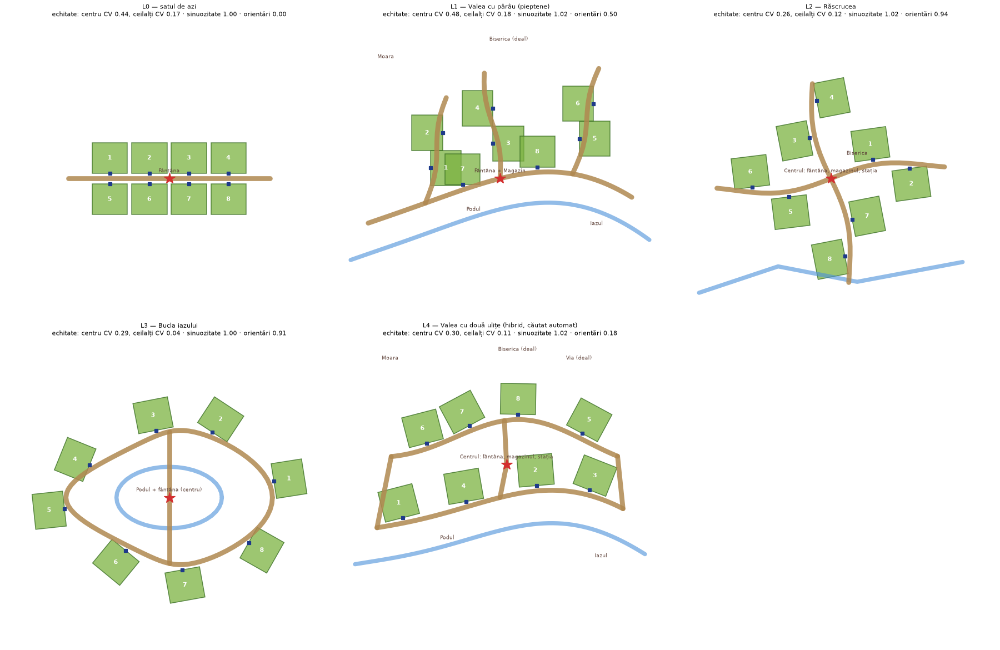

# Satul viu: cercetare și opțiuni (2026-10-18)

Omul a cerut o cercetare pe trei întrebări:

1. De ce satul arată simetric și plictisitor, și cum arată de fapt un sat moldovenesc?
2. Ce locuri ale satului pot deveni mecanici de joc și mini-jocuri?
3. Le place jocul tuturor copiilor? Ar juca fără să se plictisească?

Precizarea omului, păstrată ca principiu: **tradiția e aromă; jocul trebuie să fie interesant pentru copiii de azi.**

Documentul arată opțiunile, cu dovezi, și recomandă o combinație. Nu e un plan aprobat.

## 0. Pe scurt

**Cele 12 constatări care schimbă decizii**

1. **Satul actual e simetric și inechitabil.** Ogrăzile de la capete sunt de 2,9 ori mai departe de centru decât cele din mijloc. Expunerea la raiduri (distanța medie față de celelalte ogrăzi) variază cu 17%: ogrăzile din mijloc sunt jefuite mai ușor. Măsurat pe graful drumurilor (§2).
2. **Satele reale nu au drumuri sinuoase.** Am măsurat Trebujeni, Sculeni și Țaul în OpenStreetMap:
   - drumurile principale sunt aproape drepte (sinuozitate mediană 1,01–1,10);
   - viața vine din apă pe o latură (râul), ulițe care urcă dealul și se înfundă, un centru la răscruce, case aliniate fiecare la ulița ei (orientări variate la nivelul satului) și distanțe neregulate față de drum (10–40 m).
   - Satul nostru are zero variație la fiecare dintre aceste măsuri.
3. **Nicio așezare liniară nu e echitabilă față de un centru unic.** Nici varianta „autentică”. Echitatea față de centru se rezolvă prin mecanică (taraba și vânzarea sunt deja panouri UI), nu prin geometrie. Geometria trebuie să echilibreze **expunerea la raid**. Două forme reușesc:
   - bucla: CV 0,04;
   - valea cu două ulițe legate: CV 0,11, față de 0,17 acum.
4. **Bucla 2025–2026 e dovedită, dar 50% din timp e „mort”.** Ziua (4 min) e pasivă pentru jucătorul de mijloc: straturile sunt pline și creaturile cresc 2–20 min. Furtul ține 3 min. Hiturile umplu ziua cu altă activitate (99 Nights, Animal Hospital: zi = slujbă, noapte = pericol).
5. **Grow a Garden 2 a lansat în iunie 2026 exact premisa noastră:** furt noaptea și apărare. Raportul spune că jucătorii fug pe servere private ca să-și protejeze grădina, deci serverele publice se golesc. Sursa e una singură, comercială.
6. **Pierderea definitivă îi face pe copii să plângă.** Clipurile cu copii care plâng la Steal a Brainrot au devenit virale. Copiii supraevaluează ce au, mai mult decât adulții (efectul de dotare). La noi, o creatură furată e pierdută definitiv. E cel mai mare risc de retenție pentru cei mici.
7. **Algoritmul Roblox s-a schimbat în aprilie 2026:** fereastra e acum de 28 de zile, cu retenția pe zilele 1, 2–7 și 8–28 și jocul cu prietenii. Primul minut contează dublu: un joc din care pleci în mai puțin de 60 s e penalizat.
8. **Nu ne putem baza pe chat sau pe notificări:**
   - sub 9 ani, chatul e oprit;
   - în Rusia, din iunie 2026, chatul e oprit complet;
   - notificările jocului ajung doar la 13+.
   Socialul trebuie să meargă fără text, iar revenirea trebuie adusă de evenimente programate (Experience Events), nu de notificări.
9. **Băieții și fetele (6–13 ani) vor lucruri diferite.**
   - Băieți: luptă 45%, acțiune 49%.
   - Fete: modă 45% (băieți 6%).
   - Aventura (43% și 43%) și joc de rol (≈ 27%) unesc ambele grupuri.
   Jocul are azi un singur drum spre statut (avere și furt). Îi lipsesc drumurile paralele: îngrijire, decor, exprimare.
10. **Meme-urile mor în câteva luni** („67” provoacă deja priviri date peste cap; „Great Meme Reset 2026”). „Italian brainrot” și „You Stole My Brainrot” au intrat în pauzele de la școală. Concluzia: **nu urmărim meme-uri, construim sisteme care produc momente de povestit** (fizică comică, combinații absurde, replici, clipuri).
11. **Cultura funcționează doar ca mecanică.** Copiii au jucat de 7 ori mai mult un joc educativ în care învățarea ERA mecanica (Zombie Division). Fără panouri cu informații.
12. **Blocant de platformă pentru publicul copiilor:**
    - Roblox Kids (5–8 ani) vede doar jocuri „Minimal/Mild”;
    - pentru cataloagele sub 16 ani, dezvoltatorul are nevoie de ID verificat, 2FA și Roblox Plus. Raportul are incertitudini, de confirmat.
    - Acum jocul e „16+ și prieteni de încredere”. **Fără acest pas, nimic din ce urmează nu ajunge la copii.**

**Recomandarea, într-o frază:** satul devine o vale cu pârâu, două ulițe legate în buclă și un centru viu, cu 6 locuri-jucărie, plus un „ceas al satului” care pornește la fiecare 6–8 minute o întâmplare pentru tot serverul (mini-joc, vizitator, pericol comun). Furtul rămâne miezul, dar fără lacrimi: creaturile „de suflet” nu se fură, iar furtul aduce răzbunare, nu doliu.

**Pachetele de opțiuni (detalii în §8)**

| Pachet | Ce conține | Efect așteptat | Cost |
|---|---|---|---|
| **A. Satul viu** | Așezarea nouă (vale, buclă, pârâu, centru), case variate cu aceeași valoare, viață ambientală (gâște, câini, săteni, rutiera) | Arată moldovenesc; raiduri echitabile; zero mecanici noi | M |
| **B. Satul-jucărie** (recomandat) | A + 6 locuri cu mecanică + „ceasul satului” cu 4 mini-jocuri + furtul fără lacrimi + drumurile paralele spre statut | Umple ziua; acoperă 6–16 ani și ambele genuri | L |
| **C. Satul-festival** | B + 6 mini-jocuri în plus + sezoane (Mărțișor, Paște, Culesul, Iarna) + bazar de schimb + co-op contra lupilor | Ritmul săptămânal și sezonier al hiturilor | XL, în valuri |

---

## 1. Metodă

**Patru fluxuri de cercetare pe web,** în paralel, cu surse citate (lista în §11):
- satul moldovenesc: morfologie, locuri, obiceiuri, jocuri de copii, folclor;
- piața Roblox 2025–2026: hituri, algoritm, demografie, ce a omorât jocuri;
- psihologia jocului la copii pe vârste: motivație, plictiseală, pierdere, accesibilitate, etică;
- generarea satelor organice și designul hărților multiplayer: echitate, performanță pe mobil.

**Verificare pe date reale.** Am descărcat din OpenStreetMap (Overpass) clădirile, drumurile și apa pentru trei sate și le-am măsurat:
- **Trebujeni:** Orheiul Vechi, valea Răutului.
- **Sculeni:** raionul Ungheni, pe Prut, legat de decorul Ungheni din GDD §19.
- **Țaul:** nordul Moldovei, cu parcul conacului.

Scriptul e `tools/research/osm_villages.py`, harta `docs/research/sate-reale-osm.png`.

**Modelarea așezărilor.** Am modelat 5 așezări de sat: cea actuală și patru alternative. Am calculat:
- echitatea, ca drum mers pe graful drumurilor de la poarta fiecărei ogrăzi;
- sinuozitatea;
- dispersia orientărilor.

Pentru varianta hibridă am căutat automat (4.000 de încercări) pozițiile cele mai echitabile. Scriptul e `tools/research/layouts.py`, figura `docs/research/asezari-comparate.png`.

**Simularea jucătorilor.** Am jucat mental, pe numerele reale din config, 6 copii-tip (persona) minut cu minut, ca să găsesc momentele moarte (§7).

**Bucla actuală, analizată pe config:**
- zi 240 s, noapte 180 s;
- creșterea durează 20 s (Cartofel) până la 1.200 s (Dovleac DJ);
- taraba se reînnoiește la 300 s;
- 4 straturi la început.

---

## 2. Satul: diagnostic și date

### 2.1 Satele reale (OpenStreetMap, rază de 900 m)

| Măsură | Trebujeni | Sculeni | Țaul | **BUNICA azi** |
|---|---|---|---|---|
| Sinuozitatea drumurilor (mediană / p90) | 1,10 / 2,12 | 1,01 / 1,10 | 1,01 / 1,16 | **1,00 / 1,00** |
| Case aliniate la drumul lor (< 10°) | 57% | 83% | 69% | **100%** |
| Case vizibil „strâmbe” (> 20°) | 30% | 7% | 14% | **0%** |
| Distanța casei față de drum (p10–p90) | 11–26 m | 12–41 m | 10–38 m | **identică** |
| Distanța până la vecinul cel mai apropiat (mediană, CV) | 32 m, CV 1,68 | 20 m, CV 0,56 | 21 m, CV 0,79 | **identică, CV 0** |
| Apă în sat | râul Răut, pe toată latura | Prutul cu meandru, lac | iazuri, parc | **niciuna** |

**Ce face un sat să pară moldovenesc** (din date, nu din clișee):

- **Apa pe o latură:** râul sau pârâul, cu drumul mare de-a lungul lui.
- **Ulițe care urcă dealul** și se ramifică sau se înfundă (Trebujeni: un „pieptene” de ulițe pe pantă).
- **Un centru la răscruce:** biserica, școala, primăria, magazinul, stația (Sculeni are toate grupate).
- **Fiecare casă e aliniată la ulița ei,** nu la o axă a satului. Pe ansamblu orientările variază, iar 7–30% din case sunt vizibil „strâmbe”.
- **Ogrăzile au adâncimi diferite,** iar distanța casei față de drum variază de 3–4 ori.
- **Golurile contează:** livezi, vii pe deal, lanuri, un iaz. Satul nu e compact.

Ce **nu** l-a făcut viu: drumurile principale curbe. Sunt aproape drepte în toate cele trei sate. Curbura e la ulițe și la vale.

### 2.2 Satul nostru și alternativele (măsurate)

Echitatea e calculată pe graful drumurilor, de la poarta fiecărei ogrăzi:
- **centru CV** = variația distanței până la centru;
- **ceilalți CV** = variația distanței medii până la celelalte 7 ogrăzi, adică expunerea la raiduri.

Ținta e un CV de cel mult 0,10 pentru ceilalți. Pragul e recomandarea mea; literatura de design de hărți dă doar principiul „simetrie funcțională, nu geometrică”.

| Așezare | Centru CV (max/min) | **Ceilalți CV** (max/min) | Orientări (0–1) | Aspect | Verdict |
|---|---|---|---|---|---|
| L0 azi: drum drept, 2×4 | 0,44 (2,89) | **0,17** (1,40) | 0,00 | grilă | simetric **și** inechitabil |
| L1 pieptene „ca Trebujeni” | 0,49 (3,84) | 0,18 (1,62) | 0,50 | autentic | cel mai inechitabil; ogrăzi suprapuse; respins |
| L2 răscrucea cu 4 ulițe | 0,26 (1,71) | 0,12 (1,28) | 0,94 | bun | bun, dar fără vale sau apă |
| L3 bucla iazului | 0,29 (2,37) | **0,04** (1,14) | 0,91 | parc, artificial | cel mai echitabil, dar nu arată a sat |
| **L4 valea cu două ulițe legate** | 0,30 (2,25) | **0,11** (1,37) | 0,18 | sat de vale | **recomandat** (+ ajustări, vezi mai jos) |

**De ce L4.** E forma din Trebujeni (drumul mare pe lângă pârâu, ulița de deal deasupra), cu o diferență: cele două drumuri sunt **legate la capete și prin mijloc**. Asta face o buclă: urmăritul are unde să ocolească, iar hoțul nu se înfundă. Centrul (fântâna, magazinul, stația) stă pe ulicioara din mijloc.

Cu 3–4 scurtături (puntea peste pârâu, o spărtură în gard, o potecă prin vie), CV-ul expunerii scade sub 0,10. Asta se poate măsura în teste, ca la `HudLayout`.

**Ce nu poate rezolva geometria:** distanța până la centru. Cele trei variante liniare au CV între 0,26 și 0,49. De aceea nimic important nu trebuie să depindă de mersul la centru:
- taraba, beciul, Caietul și vânzarea rămân panouri UI, accesibile de oriunde;
- centrul e **loc social și de evenimente**, nu un serviciu obligatoriu;
- **rutiera** (vezi §3) face un circuit și te duce la centru în câteva secunde, de oriunde.

### 2.3 Reguli pentru așezarea nouă

Reguli din cercetarea despre așezări organice (Lynch, Stålberg, hărțile multiplayer):

1. **Ordinea de construcție:** terenul (valea, pârâul, dealurile), apoi drumurile, apoi ogrăzile, apoi decorul. Nu invers.
2. **Ce e fix și ce variază:**
   - fix pentru tot jocul: tot ce decide jocul (drumuri, ogrăzi, porți, scurtături, buclele de urmărire);
   - variază per server (seed): doar cosmeticul (rufe pe sârmă, flori, grămezi de lemne, ce copac stă unde, culoarea porților).
3. **Aceeași valoare, alt aspect.** Fiecare ogradă are:
   - aceeași suprafață jucabilă;
   - aceleași două intrări: poarta mare spre uliță și o spărtură în gardul din spate;
   - același „buget de acoperire” (câte obstacole îl ascund pe hoț).
   Diferă: casa (4 variante × oglindire × culori), poziția fântânii, copacul, pergola de viță.
4. **Repere vizibile de oriunde:** biserica și moara pe dealuri, cu `LevelOfDetail = SLIM` ca să se vadă de departe fără să fie încărcate complet.
5. **Viața nu are coliziuni.** Gâștele, găinile, câinii și sătenii sunt animați pe client (CFrame), fără Humanoid, fără fizică. Serverul ține doar programul lor.
6. **Bugetul pentru un telefon slab:** ≈ 600 de draw calls și 650k triunghiuri în zona aglomerată (recomandarea Roblox). Azi o ogradă are ≈ 290k triunghiuri de decor, deci **trebuie LOD/streaming** înainte de a adăuga satul nou. Detalii în §9.

---

## 3. Locurile satului ca jucării

Fiecare loc trece **testul copilului din 2026**: „e mișto pentru un copil de 10 ani, chiar dacă nu știe nimic despre Moldova?” Tradiția dă numele, forma și sunetul. Distracția vine din fizică, viteză, colecție, haos sau exprimare.

**Vârste:** 🟢 6–8 · 🔵 9–12 · 🟣 13–16. **Cost:** S (zile), M (1–2 săptămâni), L (mai mult).

| # | Loc | Cârligul pentru copiii de azi | Mecanica | Vârste | Cost |
|---|---|---|---|---|---|
| 1 | **Centrul: fântâna, magazinul, stația** | Locul unde „se întâmplă”, de unde vezi pe toată lumea | Zonă fără papuci (regula reală a fântânilor: nu te cerți lângă fântână). Avizier cu clasamente și anunțuri. Codurile se introduc la tanti de la magazin. Aici pornește „ceasul satului” (§4). | toate | S |
| 2 | **Rutiera (maxi-taxi)** | Duba absurd de plină, care sare pe gropi: comedie fizică pură | Circuit al satului la 2–3 minute. Te urci și ajungi la centru sau la orice ogradă. Aduce vizitatori: negustorul de semințe rare sau „rudele de la oraș” cu un cadou. Copiii se înghesuie în ea: momente de clip. | 🟢🔵🟣 | M |
| 3 | **Ulița cu gâște** | Gâsca furioasă e un meme universal (Untitled Goose Game) | Gâștele traversează în stol. Dacă treci prin ele, sâsâie și te ciupesc (mic recul), iar hoțul e trădat de gălăgie. Poți „angaja” o gâscă de pază la poartă. | 🟢🔵 | M |
| 4 | **Iazul cu rațe** | Pescuitul a dovedit că ține copiii ore întregi (Fisch: 60k–160k jucători simultan) | Pescuit simplu: arunci, aștepți tremurul, tragi în ritm. Prinzi „ingrediente-creatură” (crap-rachetă, broasca DJ) și gunoaie amuzante (o cizmă). Iarna, patinaj. Noaptea, broaștele cântă. | toate | M |
| 5 | **Pârâul și puntea** | Sărituri, balans, ape în care cazi | Scurtătură: puntea îngustă e mai rapidă, dar papucul te aruncă în apă (stropi). Pietre de trecut prin vad: o mini-cursă cu obstacole (obby) naturală. | 🟢🔵 | S |
| 6 | **Lanul de porumb** | Labirint, ascunzătoare, frică plăcută | Noaptea e ascunzătoarea hoților. Ziua e labirint de curse sau de-a v-ați ascunselea (§5). Știuletele roșu e o găsire rară, norocoasă (din clacă). | 🔵🟣 | M |
| 7 | **Livada de cireșe a mătușii** | Furtul „voie” de la un NPC, fără să pierzi nimic | Omagiu Creangă, fără lecție: cireși publici. Culegi cât poți până te prinde mătușa Mărioara cu urzicile. Mini-joc de 60 s pentru cei mici. | 🟢🔵 | S |
| 8 | **Via de pe deal** | Rânduri lungi pentru urmăriri; zdrobit de struguri cu picioarele | Coridoare de fugă. Toamna: culesul și zdrobitul strugurilor, un joc de ritm din care iese **must** (suc, fără alcool). | 🔵🟣 | M |
| 9 | **Stâna** (pe deal) | Câinele ciobănesc și oile care o iau razna | Mânat oile în țarc, în cooperare. Noaptea vin **lupii**: pericol comun pentru tot serverul (§4). Brânza e hrană care dă bonusuri creaturilor. | 🔵🟣 | L |
| 10 | **Moara de vânt** | Înălțime, palele care se învârt, privirea de sus | Reper vizibil de oriunde. Obby pe pale (verticalitate). Sus e punctul de unde vezi tot satul: pândă pentru apărători. | 🔵🟣 | M |
| 11 | **Casa de cultură / Discoteca** | Dans, muzică, „cine arată mai tare” (Dress to Impress: 651k) | Concursuri de dans cu emote-uri și vot. „Cea mai tare Bunică” (îmbraci Bunica și se votează). Hora devine joc de ritm. **Drumul fetelor spre statut**, deschis tuturor. | toate | M |
| 12 | **Terenul școlii** | Sport, echipe, rivalitate | **Oina cu papuci** (§5), fotbal cu dovleci. Turnee de 3 minute. | 🔵🟣 | M |
| 13 | **Codrul** (marginea satului) | Frică ușoară, noaptea, lanterne | Expediție cu lanterna după ingrediente rare. Muma Pădurii e un mini-boss comic, ușor înfricoșător (Mild). Deschis doar noaptea. | 🔵🟣 | L |
| 14 | **Gara și trenul** (Ungheni) | Trenul e mare, zgomotos, vine rar | Eveniment: trenul se oprește la schimbarea ecartamentului și coboară un negustor cu semințe rare. Linia taie traseele hoților (GDD §19). | toate | L |
| 15 | **Bazarul de duminică** | Taraba ta, prețurile tale, negocierea | Piață între jucători: îți pui taraba cu creaturi din beci. Schimburile de azi devin vizibile și sociale. | 🔵🟣 | L |
| 16 | **Bucătăria de vară și cuptorul** | Gătit haotic în echipă (Overcooked) | „Plăcintăria nebună” (§5). Plăcintele hrănesc creaturile (bonus de creștere). | 🔵🟣 | M |
| 17 | **Claia de fân și pătulul** | Sări de pe acoperiș în fân | Ascunzătoare. Săritura cu ragdoll. Fânul amortizează căderea după un papuc. | 🟢🔵 | S |

**Excluse sau doar decor:**
- **Biserica:** reper și clopot de dimineață, niciodată obiect de joc.
- **Troițele:** doar decor.
- **Cimitirul:** exclus.
- **Alcoolul:** via și crama devin struguri și must.
- **Simbolurile politice sau de război:** excluse.
- **„Furatul miresei”:** exclus.

---

## 4. Ceasul satului: nimic mort, niciodată

**Problema, măsurată pe config.** Pentru un jucător de mijloc (ziua 2+), un ciclu arată așa:
- **Ziua (240 s):**
  - 20–30 s de acțiune: vinzi, cumperi semințe când se reînnoiește taraba, plantezi, iei treburile;
  - apoi aștepți. Straturile sunt pline, creaturile cresc 2–20 min, taraba revine abia peste 300 s.
- **Noaptea (180 s):** e plină (furi, aperi).

Rezultat: **≈ 50% din ciclu e pasiv** pentru cine nu are ceva de decorat. Cercetarea pe copii cere o acțiune la 10–30 s, un mini-scop la 2–5 min și un vârf la 10–20 min.

**Soluția: „ceasul satului”.** La fiecare 6–8 minute (o dată pe zi și o dată pe noapte, cu ziua de 4 min), satul are o **întâmplare** pentru tot serverul:
- anunțată cu 30 s înainte, pentru că anticiparea e jumătate din plăcere;
- de 60–120 s;
- cu recompensă pentru participare, nu doar pentru câștig;
- opțională (cine vrea își vede de ogradă).

| Întâmplare | Când | Tip | Inspirația | Pentru cine |
|---|---|---|---|---|
| **Gâștele au scăpat** | zi | prins gâște, haos fizic | ulița cu gâște | 🟢🔵 |
| **Rutiera aduce un negustor** | zi | ofertă de semințe rare, cine ajunge primul | rutiera, bazarul | toate |
| **Ploaie de cireșe** | zi | culesul rapid din livada publică | Creangă, cireșii | 🟢🔵 |
| **Trece o nuntă** | zi | horă-parada pe uliță; cine se prinde în horă ia confetti și bonus | nunta, hora | toate |
| **Concurs la Discotecă** | zi | dans sau „Cea mai tare Bunică”, cu vot | casa de cultură | toate (girls-friendly) |
| **Oina cu papuci** | zi | 4v4, 3 min | oina | 🔵🟣 |
| **Lupii la stână** | noapte | toată lumea apără oile împreună (co-op contra serverului) | stâna | 🔵🟣 |
| **Ceața** | noapte | vizibilitate mică, favorizează hoții 60 s | vremea | 🔵🟣 |
| **Muma Pădurii iese din codru** | noapte (rar) | mini-boss comic, toată lumea o alungă cu papuci | folclor | 🔵🟣 |
| **Trenul de la Ungheni** | o dată pe oră | negustor rar, eveniment mare | GDD §19 | toate |

**Regula de aur, din eșecurile hiturilor.** Grow a Garden a obosit când evenimentele au devenit previzibile și aglomerate:
- rotim întâmplările;
- maximum o întâmplare activă odată;
- niciuna nu se cumpără cu Robux;
- sâmbăta rămâne „Bunica se supără”, echivalentul Admin Abuse.

**Pentru cine e singur pe server:** întâmplările merg și cu un singur jucător. NPC-urile (vecinii, gâștele, lupii) umplu rolurile.

---

## 5. Mini-jocuri: catalog

Rotite de ceasul satului și pornite la locurile lor. Coloanele: jucători, durată, vârstă, cât contează îndemânarea față de noroc, „momentul de clip” (ce povestește copilul după).

| Mini-joc | Jucători | Durată | Vârste | Skill / noroc | Momentul de clip |
|---|---|---|---|---|---|
| **Prinde cocoșul** | 2–8 | 60 s | 5+ | mic / mediu | cocoșul îți sare pe cap și cucurigă |
| **Oina cu papuci** (oina + rațele și vânătorii) | 4v4 | 3 min | 8+ | mare | papucul de la 40 m în ultima secundă |
| **De-a v-ați ascunselea în porumb** | 1 caută, ceilalți se ascund | 2 min | 6+ | mediu | Bunica cu ochii legați se lovește de sperietoare (baba-oarba) |
| **Păcală se ascunde** (prop-hunt) | 1–2 caută, restul obiecte | 2–3 min | 9+ | mare | „eram găleata de lângă fântână tot timpul” |
| **Cursa cu roaba pe deal** | 2–8 | 90 s | 6+ | mediu | roaba se răstoarnă în pârâu |
| **Pescuitul la iaz** | oricâți, oricând | liber | 6+ | mic → mare | crapul-rachetă de 3 metri |
| **Zdrobitul strugurilor** | 2–4 | 60 s | 7+ | ritm | stropii de must pe toată lumea |
| **Plăcintăria nebună** (co-op) | 2–4 | 2 min | 8+ | mediu | plăcinta zboară peste gard |
| **Ciocnitul ouălor** | 1v1 | 30 s | 5+ | mic | oul tău de aur rezistă la 10 ciocniri |
| **Țară, țară, vrem ostași** | 2 echipe | 2 min | 8+ | fizic | lanțul se rupe și toți cad grămadă |
| **Obby-ul morii** | solo / cursă | 60–90 s | 7+ | mare | săritura de pe pala de sus |
| **Hora-ritm** | 3+ | 60 s | 6+ | ritm | cercul perfect cheamă Curcubeul |
| **Șotronul de pe uliță** | solo | 20 s | 5+ | mic | record pe server |
| **Lupii la stână** (apărare co-op) | tot serverul | 2 min | 8+ | mediu | ultimul lup gonit cu făcălețul |

**Ce aleg pentru pachetul B** (impact pe vârste și genuri, cost):
1. Oina cu papuci, pentru că refolosește papucul și e sportul jocului.
2. Ascunselea în porumb, pentru 6–12 ani, cu sau fără text.
3. Discoteca, pentru drumul exprimării, apreciat de fete.
4. Pescuitul, pentru calm, colecție și ziua liniștită.

Toate patru au un rol pentru un copil de 7 ani **și** unul pentru unul de 14.

---

## 6. Furtul fără lacrimi și drumurile paralele spre statut

### 6.1 Pierderea

Azi, o creatură furată e pierdută definitiv. Cercetarea pe copii arată două lucruri: copiii supraevaluează ce dețin (efectul de dotare), iar o pierdere neanunțată și ireversibilă e motivul clasic de plâns și de abandon. Steal a Brainrot a ajuns pe știri tocmai cu clipurile copiilor care plâng. Grow a Garden 2 își pierde jucătorii pe servere private.

| Opțiune | Cum merge | Pentru | Contra |
|---|---|---|---|
| **F0. Ca azi** | furtul mută creatura definitiv (plafon 2/noapte, scut 60 s) | tensiune maximă | lacrimi, abandon la cei mici, servere private |
| **F1. Creaturile de suflet** | până la 3 creaturi marcate „de suflet” (inimă) nu pot fi furate; restul, ca azi | simplu, copilul își protejează iubitele; tensiunea rămâne pe restul | cine pune toate cele mai bune la „suflet” scade miza; se echilibrează cu sloturile |
| **F2. Răzbunarea** | furtul lasă o urmă: victima vede hoțul pe hartă până în zori și primește +50% din prețul creaturii dacă o fură înapoi | transformă pierderea în poveste și urmărire | mai mult cod; nu ajută copilul care nu îndrăznește să fure |
| **F3. Puiul** | hoțul primește un **pui** (copie mică, venit de 25%) care crește; originalul rămâne, dar e „speriat” (fără venit 10 min) | nimeni nu pierde nimic definitiv | slăbește fantezia furtului; inflație de creaturi |
| **F4. Bunica recuperează** | în zori, Bunica „recuperează” o creatură furată dacă hoțul n-a pus-o la beci | apărarea capătă sens și după ce a mers prost | complicat de explicat fără text |

**Recomandarea: F1 + F2 împreună.** Copilul mic își apără „sufletul” fără stres, iar furtul rămâne o poveste cu urmare, nu un doliu. Se arată fără text: inima pe creatură, săgeata spre hoț, Bunica țipând „Fugi după el!”.

### 6.2 Drumuri paralele spre statut

Azi există un singur drum: avere și furt. Hiturile au mai multe, iar cercetarea pe gen cere rute paralele, niciuna obligatorie și niciuna „pentru fete” sau „pentru băieți”.

| Drum | Ce arată celorlalți | Există? | Ce lipsește |
|---|---|---|---|
| **Bogăția** | lei, creaturi rare, gardul de laudă | da | — |
| **Isteția** (hoț și apărător) | coloana Papuci, lovitura nopții | da | titluri vizibile („Hoțul satului”, „Papucul de aur”) |
| **Colecția** | Caietul Bunicii | da (nou) | silueta creaturilor nedescoperite (curiozitate) |
| **Grija** | creaturi îngrijite, fericite | nu | hrănit, mângâiat, „creatura zâmbește”; bonus mic de venit |
| **Exprimarea** | ograda ta, Bunica ta, poarta ta | parțial (cosmetice pe Robux) | **decorul ogrăzii pe lei**: flori, covoare pe gard, culoarea porții; ținute pentru Bunica; concursul de la Discotecă |
| **Priceperea** | recorduri la mini-jocuri | nu | clasamente pe mini-joc, medalii |
| **Ajutorul** | „l-ai ajutat pe X” | nu | recompensă pentru apărarea prietenilor, clacă (ajuți la recoltă) |

### 6.3 Sisteme care produc momente de povestit (nu meme-uri)

- **Creaturi-combinație:** două creaturi rare pe straturi alăturate pot da un **hibrid** cu nume absurd, generat din bucăți („Plăcintonio-Turbo”, „Mămăliga-Ninja”). E exact energia „Italian brainrot”, dar produsă de joc și unică pe server: momentul „uite ce am făcut”.
- **Replicile Bunicii** ca semnătură, vocea fiind deja în joc: „Na-ți papucul!” e meme-ul nostru, nu unul împrumutat.
- **Fizică comică peste tot:** ragdoll în pârâu, gâște, rutiera, roaba, fânul.
- **„Lovitura nopții”** există deja. Următorul pas e ca momentul să poată fi salvat ca clip (Roblox Moments, pentru 13+, de confirmat când API-ul e disponibil).

---

## 7. Simularea copiilor: ar juca fără să se plictisească?

Șase copii-tip, jucați minut cu minut pe numerele reale din config. ✅ = distrat, 😐 = așteaptă, ❌ = pleacă.

**Ana, 7 ani, Chișinău.** Telefonul mamei, citește greu, iubește animăluțele.
- **Azi:**
  - 0–1 min ✅: Hoțomanul, papucul, Bunica vorbește.
  - 2–4 min 😐: nu înțelege taraba (text).
  - Prima noapte ✅: hoți vecini, alarmă.
  - 😢 îi fură un vecin NPC Mămăligatorul preferat → ❌, plânge, nu mai intră.
- **Cu B:**
  - pune inimă pe Mămăligator (F1);
  - prinde gâște la prima întâmplare;
  - pescuiește;
  - culege cireșe de la mătușa.
- **Verdict:** azi ❌ (pierderea), cu B ✅.

**Matei, 10 ani, Bălți.** Competitiv, joacă cu fratele de 13 ani.
- **Azi:**
  - nopțile ✅: furt, papuc;
  - ziua 😐: „stăm și așteptăm noaptea”;
  - după 2 ore a văzut tot.
- **Cu B:**
  - ziua are Oina cu papuci, cursa cu roaba și clasamente pe mini-joc;
  - noaptea, lupii la stână îi pune pe frați în aceeași echipă.
- **Verdict:** azi 😐 (golul de zi), cu B ✅.

**Sofia, 11 ani, Iași.** Colecționează și decorează, se uită la Dress to Impress.
- **Azi:**
  - Caietul ✅ (colecția);
  - nimic de decorat fără Robux 😐;
  - furtul o stresează 😐.
- **Cu B:**
  - decor pe lei (flori, covoare pe gard, poarta ei);
  - concursul de la Discotecă;
  - „Cea mai tare Bunică”;
  - inimile protejează colecția.
- **Verdict:** azi 😐, cu B ✅ (aici e cea mai mare diferență).

**Dima, 13 ani, rusofon din Moldova.** Vrea să stea cu prietenii, chatul limitat.
- **Azi:**
  - Familie/Rivali ✅;
  - nu poate vorbi, iar textele RU cad pe EN 😐.
- **Cu B:**
  - roata de mesaje rapide (fără chat);
  - Discoteca ca loc de stat;
  - textele RU scrise de mână (GDD).
- **Verdict:** azi 😐, cu B ✅ dacă vine și RU.

**Lucas, 10 ani, São Paulo.** Mobil ieftin, nu știe nimic despre Moldova.
- **Azi:**
  - papucul e universal ✅ („la chancla”);
  - satul nu-i spune nimic 😐;
  - telefonul se încălzește (290k triunghiuri pe ogradă).
- **Cu B:**
  - rutiera, gâștele și roaba sunt comedie universală;
  - LOD/streaming obligatoriu.
- **Verdict:** azi 😐 (performanță), cu B ✅ doar cu §9.

**Andrei, 15 ani, Cluj.** Vrea skill vizibil și clipuri.
- **Azi:**
  - lovitura nopții ✅;
  - plafonul de skill e mic 😐.
- **Cu B:**
  - Oina cu papuci (skill mare);
  - Păcală se ascunde (prop-hunt, trucuri);
  - obby-ul morii cu record pe server;
  - clipuri.
- **Verdict:** azi 😐, cu B ✅.

**Concluzia simulării.** Azi jocul ține bine **un singur profil** (băiat competitiv, 9–12 ani, care are răbdare ziua). Pachetul B acoperă toate cele șase profiluri. Cele trei schimbări cu cel mai mare efect sunt:
1. creaturile de suflet (F1);
2. ceasul satului (golul de zi);
3. decorul pe lei (drumul exprimării).

---

## 8. Pachetele de opțiuni, evaluate

Note de la 1 la 5 (5 = cel mai bun). Pentru retenție, notele sunt estimări calitative din cercetare, nu măsurători.

| Criteriu | A. Satul viu | **B. Satul-jucărie** | C. Satul-festival |
|---|---|---|---|
| Arată moldovenesc (fără clișee) | 5 | 5 | 5 |
| Echitatea raidurilor (CV ≤ 0,10) | 5 | 5 | 5 |
| Umple ziua (golul de 50%) | 2 | 5 | 5 |
| Acoperă 6–8 ani | 2 | 4 | 5 |
| Acoperă fete și băieți | 2 | 4 | 5 |
| Retenție D2–7 (motive de revenire) | 2 | 4 | 5 |
| Retenție D8–28 (sezoane, colecție) | 1 | 3 | 5 |
| Risc tehnic / performanță pe mobil | 3 | 3 | 2 |
| Cost | M | L | XL (în valuri) |

**Recomandare: B, construit în ordinea impactului, cu C ca drum ulterior** (pe valuri săptămânale, după modelul „update sâmbăta” al hiturilor):

1. **Platforma:** publicul copiilor (ID verificat, 2FA, Roblox Plus, chestionarul de maturitate „Mild”). Necesită omul; cost zero.
2. **Creaturile de suflet (F1) și răzbunarea (F2):** cost S, efect imediat pe abandon.
3. **Performanța** (LOD, streaming, buget de triunghiuri): condiție pentru satul nou.
4. **Satul nou (L4):** vale, pârâu, două ulițe în buclă, centru, case variate, viață ambientală. Cu test de echitate în CI.
5. **Ceasul satului cu primele 4 întâmplări:** gâștele, negustorul cu rutiera, ploaia de cireșe, lupii.
6. **Mini-jocurile din B:** oina, ascunselea în porumb, Discoteca, pescuitul.
7. **Decorul pe lei și titlurile:** drumurile paralele spre statut.
8. **Roata de mesaje rapide și textele RU, ES, PT.**
9. **Valurile C:** sezoane, bazar, mini-jocuri noi, câte unul pe săptămână.

---

## 9. Ce ne-a scăpat (puncte oarbe)

1. **Publicul copiilor e închis.** Jocul e „16+ și prieteni de încredere”. Pentru Roblox Kids (5–8) și Select (9–15) trebuie:
   - chestionarul de maturitate completat corect (papucul repetat înseamnă probabil „Mild”);
   - ID verificat, 2FA și Roblox Plus pentru dezvoltator (de confirmat la sursă).
2. **Pierderea definitivă** (§6.1) e cel mai mare risc pentru cei mici.
3. **Ziua e pasivă** (§4): ≈ 50% din ciclu.
4. **Performanța pe telefon:** ≈ 290k triunghiuri de decor pe ogradă, de 8 ori pe server. 80% din jucătorii Roblox sunt pe mobil, iar telefoanele slabe care se blochează cresc rata de plecare în primul minut, o măsură penalizată de algoritm. LOD și streaming înainte de orice decor nou.
5. **Fără chat, fără notificări:** sub 9 ani nu au chat, în Rusia chatul e oprit, iar notificările ajung doar la 13+. Trebuie roata de mesaje rapide și Experience Events pentru sâmbete (cu imagini, abonare pe pagina jocului).
6. **Fereastra de 28 de zile:** zilele 8–28 cer obiective lungi. Avem renașterea și Caietul; lipsesc sezoanele.
7. **Jucătorul amețit nu face nimic** cât e lovit (1,2 s, mic). Jucătorul care pierde un mini-joc trebuie să rămână activ: fantomă care aruncă cu ceva, ajutor sau spectator cu reacții.
8. **Curiozitate:** în Caiet, creaturile nedescoperite să aibă siluetă, nu „???”. Golul mic și închidibil atrage, golul mare descurajează.
9. **Ajutor pentru cine rămâne în urmă,** vizibil și comic, mai ales în mini-jocuri. Fără penalizări ascunse pentru cei din față.
10. **Alarma în lanț:** în sate, câinii își pasează lătratul din curte în curte. Câinii vecinilor ar putea anunța un hoț care trece, o mecanică naturală și gratuită.
11. **Locuri fără bătaie:** fântâna (regulă reală) și Discoteca. Copiii mici au nevoie de spații unde nu pot fi loviți.
12. **Păcală ca mascotă de hoț:** un personaj-farsor din folclor, perfect pentru tonul jocului, cu skin sau mentor. Înrudit: Prâslea, care păzește merele de aur noaptea, e exact structura paznic–hoț.
13. **Coduri la fiecare update,** introduse la tanti de la magazin. Standard pe Roblox, cost S.
14. **Echilibrarea pe vârste:** chatul și potrivirea pe servere sunt pe grupe de vârstă. Mini-jocurile trebuie să meargă și cu 2 jucători, și cu 8.
15. **Trading:** azi arătăm valorile, dar lipsește avertismentul pentru schimburi foarte dezechilibrate (anti-păcăleală).
16. **„Admin Abuse”:** „Bunica se supără” trebuie să rămână surpriză. Rotim conținutul, ca să nu devină previzibil (eșecul Grow a Garden).
17. **Sezoanele moldovenești ca evenimente săptămânale de calendar,** nu ca lecții:
    - Mărțișor: martie;
    - Paște: ciocnitul ouălor;
    - Drăgaica: iunie, coroane aruncate pe acoperiș;
    - Culesul: septembrie–octombrie, struguri, porumb, știuletele roșu;
    - Hramul: casă deschisă, furtul oprit, vizite;
    - Iarna: colinde, Capra, Ursul, măștile de Malanca (deghizare: Bunica nu te recunoaște).

---

## 10. Cum validăm

**Măsurători, unele deja instrumentate (Analytics):**
- plecarea în primele 60 s și în 61–180 s;
- zilele de joc pe zilele 1, 2–7 și 8–28;
- jocul cu prietenii;
- participarea la întâmplări, pe tip;
- timpul pasiv pe zi: secundele fără nicio acțiune;
- furturile pe noapte și **plecarea în 5 minute după un furt suferit** (indicatorul de lacrimi);
- distribuția pe dispozitive.

**Teste A/B, cu Roblox Experiments la pasul 7, dacă omul îl cere:**
- F0 vs F1 (creaturile de suflet): plecarea după furt și D1;
- ceasul satului la 6 vs la 8 minute: participarea și D1.

**Teste automate:**
- **echitatea satului:** CV-ul expunerii ≤ 0,10, max/min ≤ 1,25, pe graful drumurilor real, în CI;
- **bugetul de triunghiuri pe ogradă:** ≤ 120k cu LOD;
- **auditul de telefon** (există deja, pasul 15l) extins la locurile noi.

**Teste cu copii:** câțiva copii din familie, cu acordul părinților (GDD §14), filmați doar ecranul.
- Se întreabă: „ce ți-a plăcut cel mai mult?” și „când ți s-a părut plictisitor?”.
- Se notează **momentele în care întreabă „acum ce fac?”**: acolo e timp mort.

---

## 11. Surse

**Satul moldovenesc**
- E. Pihurov, *Locuința tradițională a românilor din spațiul Pruto-Nistrean*, 2024. Citează monografiile Nișcani și Copanca (1930) și călători din secolul XIX: https://ibn.idsi.md/sites/default/files/imag_file/132-138_21.pdf
- EveryCulture, Moldovans: Settlements: https://www.everyculture.com/Russia-Eurasia-China/Moldovans-Settlements.html
- Tipuri de sate (adunate / răsfirate): https://www.diacronia.ro/indexing/details/A31164/pdf · gospodăria: https://www.diacronia.ro/indexing/details/A32037/pdf
- Poarta ca prag între sat și casă: https://repository.utm.md/handle/5014/12164?show=full
- Fântânile: https://pr418.com/en/library/magazines/g20051108/Meet-You-at-the-Well · https://triciaannemitchell.com/2014/09/18/water-wells-moldova-fintina/ · https://radiomoldova.md/p/72995
- Mărțișorul (UNESCO): https://moldova.travel/en/?p=14659 · Hramul: https://jurnalul.ro/timp-liber/culinar/hramul-sau-la-masa-cu-divinitatea-295811.html
- Malanca: https://www.new-east-archive.org/features/show/12448/malanka-ukrainian-moldovan-new-year-tradition-in-photographs
- Jocuri de copii: https://codanec.eu/?p=3740 · https://actualdecluj.ro/?p=105633 · Oina: https://en.wikipedia.org/wiki/Oin%C4%83
- Păcală: https://ro.wikipedia.org/wiki/P%C4%83cal%C4%83
- Nucii de pe marginea drumului: https://www.old.ipn.md/en/moldovan-gold-from-the-roadside-7966_992624.html
- Datele de hartă: © OpenStreetMap contributors (ODbL), Overpass API.

**Piața Roblox**
- Steal a Brainrot: https://en.wikipedia.org/wiki/Steal_a_Brainrot · Grow a Garden: https://en.wikipedia.org/wiki/Grow_a_Garden
- Grow a Garden 2: https://www.gosugamers.net/entertainment/news/78614-grow-a-garden-2-has-launched-on-roblox-here-s-everything-new-added-in-this-sequel · declinul (sursă comercială): https://www.mmoexp.com/News/grow-a-garden-2-is-losing-players-what-really-happened-to-the-roblox-hit.html
- Algoritmul (28 de zile): https://about.roblox.com/newsroom/2026/06/optimizing-discovery-great-games-reach-millions-players-roblox · https://create.roblox.com/docs/discovery
- Chat și vârste: https://secure.businesswire.com/news/home/20260107986568/en/Roblox-Requires-Users-Worldwide-to-Age-Check-to-Access-Chat
- Maturitatea conținutului: https://create.roblox.com/docs/production/promotion/content-maturity · Notificări (13+): https://create.roblox.com/docs/production/promotion/experience-notifications
- Rezultate Q2 2026: https://www.sec.gov/Archives/edgar/data/0001315098/000162828026051059/ex991-robloxq22026earnin.htm
- Mobil 80%: https://www.pocketgamer.biz/80-of-roblox-users-are-on-mobile-contributing-46-of-robux-revenue
- Fete / băieți 6–13: https://www.roymorgan.com/findings/10136-yas-roblox-for-young-australians-survey-december-2025
- Rusia fără chat: https://meduza.io/en/news/2026/06/11/russian-kids-can-play-roblox-again-they-just-can-t-talk-to-anyone-in-the-game
- Monetizare înșelătoare (USyd): https://www.sydney.edu.au/news-opinion/news/2026/05/17/inside-the-pay-to-play-world-of-roblox-targeting-children-.html
- Itemi aleatorii plătiți: https://create.roblox.com/docs/production/monetization/paid-random-items

**Copiii și jocul**
- NN/G, copiii ca utilizatori: https://www.nngroup.com/videos/designing-children/
- SDT în jocuri (Ryan, Rigby, Przybylski 2006): https://pure.ewha.ac.kr/en/publications/the-motivational-pull-of-video-games-a-self-determination-theory-/
- Quantic Foundry, diferențe de gen: https://quanticfoundry.com/2015/08/28/gender-differences-in-gaming/
- Atingerile pe ecran la copii: https://init.cise.ufl.edu/wp-content/uploads/sites/378/2017/03/chen-et-al-ICMI2020.pdf
- Efectul de dotare la copii: https://cognitivesciencesociety.org/cogsci20/papers/0250/index.html
- Lăzi cu premii și adolescenți (Zendle et al.): https://pmc.ncbi.nlm.nih.gov/articles/PMC6599795
- Învățarea integrată în mecanică (Habgood & Ainsworth 2011): https://shura.shu.ac.uk/3556/
- Cultura prin joc (Never Alone): https://www.culturalsurvival.org/publications/cultural-survival-quarterly/making-never-alone-kisima-innitchuna-celebrating-people
- COPPA 2025: https://jonesday.com/en/insights/2025/05/ftc-finalizes-amendments-to-coppa--rule · ICO pentru designeri de jocuri: https://www.nelsonslaw.co.uk/ico-guidance-to-game-developers/

**Așezări organice și hărți**
- Parish & Müller 2001 (L-sisteme): https://history.siggraph.org/?p=116923 · câmpuri tensoriale: https://www.sci.utah.edu/~chengu/street_sig08/street_project.htm
- Townscaper / Stålberg: https://www.gamedeveloper.com/game-platforms/how-townscaper-works-a-story-four-games-in-the-making
- Elementele lui Lynch în jocuri: https://cs.wellesley.edu/~pmwh/mvmap/papers/open_world_elements/open_world_elements.html
- Poisson disc: https://devmag.org.za/2009/05/03/poisson-disk-sampling/
- Performanța pe Roblox: https://create.roblox.com/docs/performance-optimization/design · streaming: https://create.roblox.com/docs/workspace/streaming

**Tendințe la copii (2026, surse de popularizare, de luat cu rezervă)**
- Italian brainrot: https://www.yahoo.com/lifestyle/family-relationships/article/italian-brainrot-is-the-gen-alpha-trend-confusing-every-parent-i-know--including-me-193732029.html
- Brainrot și copiii: https://theconversation.com/online-brainrot-isnt-ruining-childrens-minds-its-a-new-way-of-navigating-the-modern-internet-268623
- „Great Meme Reset 2026”: https://www.sheknows.com/parenting/articles/1234941813/great-meme-reset-2026-teens/

**Limitele acestei cercetări:**
- cifrele de jucători simultani vin în mare parte de la trackere și pot include boți;
- declinul Grow a Garden 2 are o singură sursă, comercială;
- cerințele exacte pentru cataloagele sub 16 ani trebuie confirmate în documentația Roblox;
- morfologia satului e verificată pe 3 sate. Un al patrulea, Cucuieții Noi, n-a putut fi descărcat din cauza serverelor Overpass supraîncărcate.
